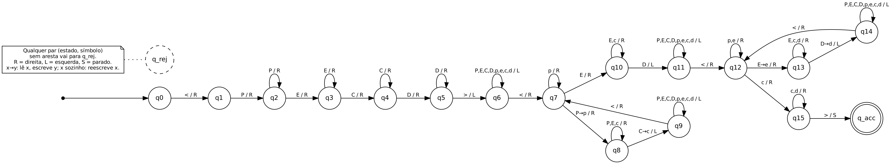

# Frente 2 — Linguagem sensível ao contexto e Autômato Linearmente Limitado (ALL)

> Implementação correspondente: [`src/all/transicoes.py`](../../src/all/transicoes.py) (tabela δ) e
> [`src/all/automato_linear.py`](../../src/all/automato_linear.py) (simulador).
> Tudo o que está neste documento (tabelas, contagens de passos, rastreamentos e diagrama) foi gerado
> ou conferido executando esse código.

---

## 1. Alfabeto e regra de aceitação

O ALL recebe o **trecho do manifesto após o `#`** (o lote). Cada símbolo é um evento:

| Símbolo | Evento |
|---|---|
| `P` | pedido |
| `E` | envio |
| `C` | confirmação (de um pedido) |
| `D` | devolução (de um envio) |

**Alfabeto de entrada:** Σ = { `P`, `E`, `C`, `D` }

**Linguagem reconhecida:**

$$L_{ALL} = \{\, P^n\, E^m\, C^n\, D^m \;\mid\; n \ge 1,\ m \ge 1 \,\}$$

**Regra de aceitação.** Uma cadeia *w* é aceita se, e somente se:

1. *w* tem o formato `P+ E+ C+ D+` (quatro blocos não vazios, nessa ordem);
2. nº de `P` = nº de `C` (todo pedido tem confirmação);
3. nº de `E` = nº de `D` (todo envio tem devolução).

As condições 2 e 3 formam uma **dependência cruzada**: o 1º bloco depende do 3º e o 2º depende do 4º,
e esses pares se intercalam (P … E … C … D). Isso não é o exemplo da lauda, que pede três blocos com
a mesma quantidade.

**Formato no fluxo integrado.** O AP já garante que o lote tem o formato `P+E+C+D+`. O ALL confere o
formato de novo porque também é testado **isoladamente** (testes de módulo com qualquer cadeia de Σ\*).
Assim, ele decide sozinho a linguagem L_ALL.

| Cadeia | \|w\| | n, m | Decisão |
|---|---|---|---|
| `PECD` | 4 | 1, 1 | aceita (menor cadeia aceita: caso-limite) |
| `PPPPEEEEECCCCDDDDD` | 18 | 4, 5 | aceita |
| `PPPPPEEEECCCCCDDDD` | 18 | 5, 4 | aceita |
| ε (vazia) | 0 | — | rejeita (caso-limite) |
| `PPPPPEEEECCCCDDDDD` | 18 | — | rejeita: 5 P × 4 C |
| `PPPPEEEEEECCCCDDDD` | 18 | — | rejeita: 6 E × 4 D |
| `PPPPEEEEDDDDCCCCCC` | 18 | — | rejeita: formato (D antes de C) |

---

## 2. Classificação da linguagem

### 2.1 L_ALL **não** é livre de contexto

**Lema do bombeamento para LLC** (Sipser, seção 2.3; Hopcroft, Motwani e Ullman, seção 7.2):
se *L* é livre de contexto, existe *p* ≥ 1 tal que toda *s* ∈ *L* com |*s*| ≥ *p* pode ser escrita
como *s* = *uvwxy*, com:

- (a) |*vwx*| ≤ *p*;
- (b) |*vx*| ≥ 1;
- (c) *u vⁱ w xⁱ y* ∈ *L* para todo *i* ≥ 0.

**Prova (por contradição).** Suponha que L_ALL seja LLC e seja *p* a constante do lema. Tome

$$s = P^p\,E^p\,C^p\,D^p \in L_{ALL}, \qquad |s| = 4p \ge p.$$

Seja *s* = *uvwxy* uma decomposição qualquer que satisfaça (a) e (b). Vamos usar *i* = 2:

- **Caso 1: *v* ou *x* contém dois símbolos diferentes.** Então, em *uv²wx²y*, aparece um símbolo
  depois de outro que deveria vir antes (por exemplo `…PEPE…`). A cadeia sai do formato
  `P+E+C+D+`, logo ∉ L_ALL.
- **Caso 2: *v* e *x* contêm, cada um, um só tipo de símbolo.** Os pares que precisam ter a mesma
  quantidade são (P, C) e (E, D). Entre o último `P` e o primeiro `C` há *p* símbolos `E`, então
  uma subcadeia que contenha `P` e `C` tem comprimento ≥ *p* + 2. Por (a), *vwx* não contém os dois.
  Pelo mesmo motivo (há *p* símbolos `C` entre eles), *vwx* não contém `E` e `D` ao mesmo tempo.
  Por (b), *vx* contém algum símbolo *a*, e o seu parceiro *a'* (P↔C, E↔D) não está em *vwx*.
  Em *uv²wx²y*, o formato continua `P+E+C+D+`, mas a quantidade de *a* passa a ser > *p* e a de
  *a'* continua *p*. Logo, *uv²wx²y* ∉ L_ALL.

Em todos os casos, (c) falha para *i* = 2. Isso contradiz o lema, então **L_ALL não é livre de
contexto**. ∎

**Intuição (por que a pilha não basta).** Uma pilha casa dependências **aninhadas**: o último
aberto é o primeiro fechado, como em `[ { } ]`, e é isso que o AP do projeto faz. Aqui as dependências
são **cruzadas**. Para comparar os `P` com os `C`, a pilha precisaria ter os `P` no topo, mas os `E`
foram empilhados por cima e ainda precisam ser lembrados até os `D`. Ao desempilhar os `E` para
alcançar os `P`, a contagem dos `E` se perde.

Hopcroft, Motwani e Ullman (seção 7.2) aplicam o mesmo raciocínio à linguagem
{0ⁱ1ʲ2ⁱ3ʲ}, que tem a mesma estrutura (renomeando 0→P, 1→E, 2→C, 3→D).

### 2.2 L_ALL **é** sensível ao contexto

São duas justificativas independentes.

**(i) Pelo autômato.** Pelo teorema de Kuroda (1964), uma linguagem sem ε é sensível ao contexto se,
e somente se, é reconhecida por um autômato linearmente limitado. A seção 3 apresenta um ALL que
**decide** L_ALL: ele para em toda entrada (seção 7) e usa só as *n* células da entrada mais os dois
marcadores (seção 6). Logo, L_ALL é sensível ao contexto.

**(ii) Por uma gramática.** Na definição de Menezes, uma gramática sensível ao contexto (monotônica)
tem toda produção α → β com |α| ≤ |β|. A gramática abaixo gera L_ALL:

G = ({ S, T, X, Y }, { P, E, C, D }, R, S), onde `X` "vira" `C` e `Y` "vira" `D`:

```
R1:  S  → P S X  |  P T X        gera Pⁿ … Xⁿ
R2:  T  → E T Y  |  E Y          gera Eᵐ Yᵐ   →  forma Pⁿ Eᵐ Yᵐ Xⁿ
R3:  Y X → X Y                    leva todos os X para antes dos Y
R4:  E X → E C                    um X só vira C se estiver logo após E ou C
     C X → C C
     C Y → C D                    um Y só vira D se estiver logo após C ou D
     D Y → D D
```

Todas as produções têm |α| ≤ |β|. **Correção (resumo):** R1 e R2 geram Pⁿ Eᵐ Yᵐ Xⁿ. R3 e R4
preservam a quantidade de X/C (= *n*) e de Y/D (= *m*). Um `C` terminal só é criado com `E` ou `C`
à esquerda, e um `D` só com `C` ou `D` à esquerda. Como terminais nunca são reescritos nem trocados de
lugar, a parte final de qualquer cadeia terminal é Cⁿ Dᵐ. A gramática foi conferida por força bruta:
ela gera exatamente as 15 cadeias de L_ALL com até 12 símbolos.

Exemplo de derivação de `PPECCD` (*n* = 2, *m* = 1):

```
S ⇒ P S X ⇒ P P T X X ⇒ P P E Y X X          (R1, R1, R2)
  ⇒ P P E X Y X ⇒ P P E X X Y                (R3, R3)
  ⇒ P P E C X Y ⇒ P P E C C Y ⇒ P P E C C D  (R4: EX→EC, CX→CC, CY→CD)
```

**Conclusão:** L_ALL ∈ LSC \ LLC. A linguagem do AP (Frente 1) fica em LLC \ Regulares. As duas
etapas do validador ocupam, portanto, níveis diferentes da hierarquia de Chomsky.

---

## 3. Especificação do ALL

M = (Q, Σ, Γ, δ, q0, `<`, `>`, q_acc, q_rej)

### 3.1 Estados (16 de trabalho + aceitação + rejeição = 18)

| Estado | Fase | Função |
|---|---|---|
| `q0` | início | cabeçote sobre o marcador esquerdo |
| `q1` | 1. formato | espera o primeiro `P` |
| `q2` | 1. formato | bloco de `P` |
| `q3` | 1. formato | bloco de `E` |
| `q4` | 1. formato | bloco de `C` |
| `q5` | 1. formato | bloco de `D` (até o `>`) |
| `q6` | 1. formato | volta ao marcador esquerdo |
| `q7` | 2. casa P–C | procura o próximo `P` não marcado |
| `q8` | 2. casa P–C | procura o `C` correspondente |
| `q9` | 2. casa P–C | volta ao início (par P/C marcado) |
| `q10` | 3. sobra de C | confere que não sobrou `C` sem par |
| `q11` | 3. sobra de C | volta ao início |
| `q12` | 4. casa E–D | procura o próximo `E` não marcado |
| `q13` | 4. casa E–D | procura o `D` correspondente |
| `q14` | 4. casa E–D | volta ao início (par E/D marcado) |
| `q15` | 5. sobra de D | confere que não sobrou `D` sem par |
| `q_acc` | — | aceitação (para) |
| `q_rej` | — | rejeição (para) |

### 3.2 Alfabetos e marcadores

- **Entrada:** Σ = { `P`, `E`, `C`, `D` }
- **Fita:** Γ = { `P`, `E`, `C`, `D`, `p`, `e`, `c`, `d`, `<`, `>` }
  - minúscula = símbolo **já casado** (marcado);
  - `<` e `>` = marcadores de borda (∈ Γ \ Σ), fixos e nunca sobrescritos.
- **Movimentos:** `R` = direita, `L` = esquerda, `S` = permanece. As letras D/E não são usadas
  para movimento, para não confundir com os símbolos `D` e `E`.

### 3.3 Configuração inicial

Fita `< w₁ w₂ … wₙ >`, estado `q0`, cabeçote na célula 0 (sobre `<`).
Para o lote do cenário de integração:

```
q0 | cab=0 | [<]PPEEECCDDD>
```

### 3.4 Função de transição

δ : Q × Γ → Q × Γ × {L, R, S} é **parcial** e **determinística** (no máximo uma transição por par
(estado, símbolo)). Todo par ausente leva a `q_rej`. São **67 transições** no total.

Tabela compacta: uma linha com vários símbolos lidos representa uma transição para cada símbolo.
"(mesmo)" significa que o símbolo lido é reescrito sem mudança.

| Estado | Lê | Escreve | Move | Próximo | Papel |
|---|---|---|---|---|---|
| `q0` | `<` | `<` | R | `q1` | sai do marcador |
| `q1` | `P` | `P` | R | `q2` | 1º símbolo deve ser `P` |
| `q2` | `P` | `P` | R | `q2` | bloco P |
| `q2` | `E` | `E` | R | `q3` | início do bloco E |
| `q3` | `E` | `E` | R | `q3` | bloco E |
| `q3` | `C` | `C` | R | `q4` | início do bloco C |
| `q4` | `C` | `C` | R | `q4` | bloco C |
| `q4` | `D` | `D` | R | `q5` | início do bloco D |
| `q5` | `D` | `D` | R | `q5` | bloco D |
| `q5` | `>` | `>` | L | `q6` | formato OK |
| `q6` | `P E C D p e c d` | (mesmo) | L | `q6` | volta |
| `q6` | `<` | `<` | R | `q7` | começa a casar P–C |
| `q7` | `p` | `p` | R | `q7` | pula P já casados |
| `q7` | `P` | **`p`** | R | `q8` | marca um P |
| `q7` | `E` | `E` | R | `q10` | todos os P casados |
| `q8` | `P E c` | (mesmo) | R | `q8` | procura C livre |
| `q8` | `C` | **`c`** | L | `q9` | marca o C par |
| `q9` | `P E C D p e c d` | (mesmo) | L | `q9` | volta |
| `q9` | `<` | `<` | R | `q7` | próxima volta |
| `q10` | `E c` | (mesmo) | R | `q10` | não pode haver C livre |
| `q10` | `D` | `D` | L | `q11` | nenhum C sobrou |
| `q11` | `P E C D p e c d` | (mesmo) | L | `q11` | volta |
| `q11` | `<` | `<` | R | `q12` | começa a casar E–D |
| `q12` | `p e` | (mesmo) | R | `q12` | pula P e E já casados |
| `q12` | `E` | **`e`** | R | `q13` | marca um E |
| `q12` | `c` | `c` | R | `q15` | todos os E casados |
| `q13` | `E c d` | (mesmo) | R | `q13` | procura D livre |
| `q13` | `D` | **`d`** | L | `q14` | marca o D par |
| `q14` | `P E C D p e c d` | (mesmo) | L | `q14` | volta |
| `q14` | `<` | `<` | R | `q12` | próxima volta |
| `q15` | `c d` | (mesmo) | R | `q15` | não pode haver D livre |
| `q15` | `>` | `>` | S | **`q_acc`** | ACEITA |

### 3.5 Tabela em forma de matriz

Cada célula mostra (próximo estado, escrito, movimento). `·` significa sem transição, ou seja,
vai para `q_rej`. Esta forma é a mais rápida para **prever a decisão** de uma cadeia nova na arguição.

| Estado | `<` | `P` | `E` | `C` | `D` | `p` | `e` | `c` | `d` | `>` |
|---|---|---|---|---|---|---|---|---|---|---|
| `q0` | q1, <, R | · | · | · | · | · | · | · | · | · |
| `q1` | · | q2, P, R | · | · | · | · | · | · | · | · |
| `q2` | · | q2, P, R | q3, E, R | · | · | · | · | · | · | · |
| `q3` | · | · | q3, E, R | q4, C, R | · | · | · | · | · | · |
| `q4` | · | · | · | q4, C, R | q5, D, R | · | · | · | · | · |
| `q5` | · | · | · | · | q5, D, R | · | · | · | · | q6, >, L |
| `q6` | q7, <, R | q6, P, L | q6, E, L | q6, C, L | q6, D, L | q6, p, L | q6, e, L | q6, c, L | q6, d, L | · |
| `q7` | · | q8, p, R | q10, E, R | · | · | q7, p, R | · | · | · | · |
| `q8` | · | q8, P, R | q8, E, R | q9, c, L | · | · | · | q8, c, R | · | · |
| `q9` | q7, <, R | q9, P, L | q9, E, L | q9, C, L | q9, D, L | q9, p, L | q9, e, L | q9, c, L | q9, d, L | · |
| `q10` | · | · | q10, E, R | · | q11, D, L | · | · | q10, c, R | · | · |
| `q11` | q12, <, R | q11, P, L | q11, E, L | q11, C, L | q11, D, L | q11, p, L | q11, e, L | q11, c, L | q11, d, L | · |
| `q12` | · | · | q13, e, R | · | · | q12, p, R | q12, e, R | q15, c, R | · | · |
| `q13` | · | · | q13, E, R | · | q14, d, L | · | · | q13, c, R | q13, d, R | · |
| `q14` | q12, <, R | q14, P, L | q14, E, L | q14, C, L | q14, D, L | q14, p, L | q14, e, L | q14, c, L | q14, d, L | · |
| `q15` | · | · | · | · | · | · | · | q15, c, R | q15, d, R | q_acc, >, S |

---

## 4. Como o ALL decide (justificativa da modelagem)

A memória de trabalho é a **própria fita**: em vez de contadores, o ALL troca uma maiúscula por uma
minúscula para registrar "já casei este símbolo".

1. **Formato (q1–q6).** Uma passada para a direita confere `P+E+C+D+`, como um AFD embutido. Ao
   chegar em `>`, volta até `<`. Depois desta fase, as próximas sabem que os blocos estão na ordem.
2. **Casa P–C (q7–q9).** A cada volta, marca o `P` livre mais à esquerda (`P→p`) e o `C` livre mais à
   esquerda (`C→c`, pulando os `E` e os `c`) e volta ao `<`.
   **Invariante:** após *k* voltas, a fita é `< pᵏ Pⁿ⁻ᵏ Eᵐ cᵏ Cⁿ'⁻ᵏ Dᵐ' >`.
   - Se faltar `C` para um `P`, o cabeçote em `q8` chega a um `D` → rejeita (mais P que C).
3. **Sobra de C (q10–q11).** Quando `q7` encontra `E`, todos os `P` foram casados. O ALL anda até o
   primeiro `D` pulando `E` e `c`. Encontrar um `C` livre → rejeita (mais C que P).
4. **Casa E–D (q12–q14).** Mesmo esquema da fase 2 para o par (E, D).
   - Se faltar `D` para um `E`, `q13` chega a `>` → rejeita (mais E que D).
5. **Sobra de D (q15).** Quando `q12` encontra `c`, todos os `E` foram casados. O ALL anda até `>`
   pulando `c` e `d`. Encontrar um `D` livre → rejeita (mais D que E). Chegar a `>` → **aceita**.

Logo, o ALL aceita ⇔ formato correto ∧ #P = #C ∧ #E = #D ⇔ *w* ∈ L_ALL.

---

## 5. Condições de aceitação e rejeição

- **Aceitação:** somente pela transição (`q15`, `>`) → `q_acc`. Isso exige que todos os quatro blocos
  tenham sido completamente casados.
- **Rejeição:** qualquer par (estado, símbolo) sem transição leva a `q_rej`. Cada causa de rejeição
  corresponde a um ponto específico da tabela:

| Onde para | Significado | Exemplo (18 símbolos) | Passos |
|---|---|---|---|
| `q1`…`q5` | formato errado | `PPPPEEEEDDDDCCCCCC` (para em `q3` lendo `D`) | 9 |
| `q5` lendo `P` | símbolo após o bloco D | `PPPPEEEECCCCDDDDDP` | 18 |
| `q8` lendo `D` | mais `P` que `C` | `PPPPPEEEECCCCDDDDD` | 144 |
| `q10` lendo `C` | mais `C` que `P` | `PPPPEEEEECCCCCDDDD` | 144 |
| `q13` lendo `>` | mais `E` que `D` | `PPPPEEEEEECCCCDDDD` | 319 |
| `q15` lendo `D` | mais `D` que `E` | `PPPPEEEECCCCDDDDDD` | 281 |
| `q1` lendo `>` | entrada vazia | ε | 1 |

**Roteiro para prever a decisão de uma cadeia nova:**

1. Ela tem o formato `P+E+C+D+`? Se não, rejeita na fase 1, no primeiro símbolo fora de ordem.
2. Compare #P com #C: se #P > #C, rejeita em (q8, D); se #P < #C, rejeita em (q10, C).
3. Compare #E com #D: se #E > #D, rejeita em (q13, >); se #E < #D, rejeita em (q15, D).
4. Caso contrário, aceita em (q15, >).

---

## 6. Limite da fita: *n* células + 2 marcadores

- O simulador aloca `fita = [<] + w + [>]`, com exatamente *n* + 2 células e nenhuma outra estrutura
  de memória que cresça com a entrada. Estado, posição do cabeçote e contador de passos são finitos
  ou só servem para o rastreamento.
- **Células graváveis:** apenas 1…*n*. Nelas, a única escrita que muda o símbolo é
  maiúscula → minúscula (`P→p`, `C→c`, `E→e`, `D→d`).
- **Marcadores:** toda transição que lê `<` ou `>` reescreve o próprio marcador. Os movimentos são:

| Lê | Transições | Movimento |
|---|---|---|
| `<` | (q0,<), (q6,<), (q9,<), (q11,<), (q14,<) | sempre **R** (para dentro) |
| `>` | (q5,>) | **L** (para dentro) |
| `>` | (q15,>) | **S** (para em q_acc) |

  Não existe transição que mova para a esquerda sobre `<` nem para a direita sobre `>`. Por isso o
  cabeçote nunca sai do intervalo [0, *n*+1].
- O simulador também **verifica** isso a cada passo: lança erro se a tabela tentar sobrescrever um
  marcador ou mover o cabeçote para fora da fita. Nenhum teste dispara esse erro.
- Entrada vazia: fita `<>` (*n* = 0), `q0 → q1` e rejeição em (q1, `>`).

---

## 7. Terminação e número de passos

- **Determinismo:** cada par (estado, símbolo) tem no máximo uma transição. Não há alternativas
  para explorar.
- **Potencial que só diminui:** nenhuma transição troca minúscula por maiúscula. Cada volta das
  fases 2 e 4 converte duas maiúsculas em minúsculas, então há no máximo *n*/2 voltas de marcação.
- **Cada passada é limitada:** as passadas de formato e de conferência (q1–q5, q10, q15) só andam
  para a direita até um marcador ou até rejeitar. As voltas (q6, q9, q11, q14) só andam para a
  esquerda até `<`. Cada passada tem no máximo *n* + 1 passos.
- **Limite:** são no máximo 1 + #P + 1 + #E + 1 ≤ *n* + 3 viagens de ida e volta, com ≤ 2(*n*+1)
  passos cada:

$$\text{passos} \le 2(n+1)(n+3) = O(n^2)$$

  Esse limite foi verificado exaustivamente para **todas** as cadeias de Σ\* com até 12 símbolos
  (22.369.621 cadeias).

Passos medidos:

| Entrada | n | Decisão | Passos |
|---|---|---|---|
| `PECD` | 4 | aceita | 38 |
| `PPEEECCDDD` | 10 | aceita | 130 |
| `PPEEECCCDD` | 10 | rejeita (mais C que P) | 56 |
| `PPPPEEEEECCCCDDDDD` | 18 | aceita | 338 |
| `PPPPPEEEECCCCCDDDD` | 18 | aceita | 340 |

---

## 8. Rastreamento

Comando (cenário 1 de integração; o ALL recebe `PPEEECCDDD`):

```bash
python -m src.main "[{}[{}]]{[]}#PPEEECCDDD" --trace
# ou só o ALL:
python -m src.main "PPEEECCDDD" --so all --trace
```

Cada linha mostra passo | estado | posição do cabeçote | fita, com a célula sob o cabeçote
entre colchetes. Trechos do rastreamento real (130 passos):

```
   0 | q0    | cab=0   | [<]PPEEECCDDD>                                  configuração inicial
   1 | q1    | cab=1   | <[P]PEEECCDDD>   (leu <, escreveu <, D)
 ... fase 1: confere o formato até o '>' (passos 1–11) e volta (12–22)
  11 | q5    | cab=11  | <PPEEECCDDD[>]   (leu D, escreveu D, D)
  12 | q6    | cab=10  | <PPEEECCDD[D]>   (leu >, escreveu >, E)
  22 | q6    | cab=0   | [<]PPEEECCDDD>   (leu P, escreveu P, E)
 ... fase 2, 1ª volta: marca P e C
  23 | q7    | cab=1   | <[P]PEEECCDDD>   (leu <, escreveu <, D)
  24 | q8    | cab=2   | <p[P]EEECCDDD>   (leu P, escreveu p, D)      P → p
  28 | q8    | cab=6   | <pPEEE[C]CDDD>   (leu E, escreveu E, D)
  29 | q9    | cab=5   | <pPEE[E]cCDDD>   (leu C, escreveu c, E)      C → c
 ... 2ª volta: marca o 2º P e o 2º C
  42 | q9    | cab=6   | <ppEEE[c]cDDD>   (leu C, escreveu c, E)
 ... fase 3: q7 encontra E (acabaram os P); q10 confere que não há C livre
  51 | q7    | cab=3   | <pp[E]EEccDDD>   (leu p, escreveu p, D)
  52 | q10   | cab=4   | <ppE[E]EccDDD>   (leu E, escreveu E, D)
  57 | q11   | cab=7   | <ppEEEc[c]DDD>   (leu D, escreveu D, E)
 ... fase 4: três voltas casando E com D
  68 | q13   | cab=4   | <ppe[E]EccDDD>   (leu E, escreveu e, D)      E → e
  73 | q14   | cab=7   | <ppeEEc[c]dDD>   (leu D, escreveu d, E)      D → d
 109 | q14   | cab=9   | <ppeeeccd[d]d>   (leu D, escreveu d, E)
 ... fase 5: q12 encontra c (acabaram os E); q15 confere que não há D livre
 124 | q12   | cab=6   | <ppeee[c]cddd>   (leu e, escreveu e, D)
 125 | q15   | cab=7   | <ppeeec[c]ddd>   (leu c, escreveu c, D)
 129 | q15   | cab=11  | <ppeeeccddd[>]   (leu d, escreveu d, D)
 130 | q_acc | cab=11  | <ppeeeccddd[>]   (leu >, escreveu >, -)      ACEITA
```

> No rastreamento do simulador, a coluna de movimento usa `D` = direita, `E` = esquerda e `-` = parado.
> Neste documento usamos R/L/S.

Cenário 3 de integração (`[{}[{}]]{[]}#PPEEECCCDD`, ALL recebe `PPEEECCCDD`): depois de casar os
dois `P` com dois `C`, `q10` encontra o terceiro `C` ainda maiúsculo:

```
  ...
  55 | q10   | cab=7   | <ppEEEc[c]CDD>   (leu c, escreveu c, D)
  56 | q10   | cab=8   | <ppEEEcc[C]DD>   (leu c, escreveu c, D)
       sem transição para (q10, 'C') -> q_rej                      REJEITA (mais C que P)
```

---

## 9. Diagrama e origem



- Arquivos: [`all_diagrama.svg`](all_diagrama.svg) (vetorial, para o relatório e os slides),
  [`all_diagrama.png`](all_diagrama.png) e a fonte [`all_diagrama.dot`](all_diagrama.dot).
- **Origem:** gerado pela equipe com o script [`gerar_diagrama_all.py`](gerar_diagrama_all.py), que lê
  **a mesma tabela** usada pelo simulador (`src/all/transicoes.py`) e escreve o `.dot`. A renderização
  é feita com o Graphviz (`dot`). Por isso, diagrama e código não podem divergir. Para regenerar:

```bash
python docs/modelagem/gerar_diagrama_all.py
dot -Tsvg docs/modelagem/all_diagrama.dot -o docs/modelagem/all_diagrama.svg
dot -Tpng -Gdpi=150 docs/modelagem/all_diagrama.dot -o docs/modelagem/all_diagrama.png
```

- Arestas para `q_rej` foram omitidas por legibilidade: todo par ausente vai para lá.
- Rótulo `x / R`: lê *x*, reescreve *x*, move à direita. `x→y / L`: lê *x*, escreve *y*, move à
  esquerda.

---

## 10. Revisão da tabela `src/all/transicoes.py` (Frente 2)

| Item verificado | Resultado |
|---|---|
| Nº de estados ≥ 8 | 16 de trabalho + `q_acc` + `q_rej` = 18 ✔ |
| Determinismo | uma transição por (estado, símbolo) ✔ |
| Só *n* + 2 células; marcadores intactos; cabeçote dentro dos limites | ✔ (seção 6) |
| Decide exatamente L_ALL | ✔ igual à definição em todas as cadeias com até 9 símbolos e em 3000 aleatórias (`tests/test_implementacao.py`) |
| Para em toda entrada, com ≤ 2(n+1)(n+3) passos | ✔ verificado para todas as cadeias com até 12 símbolos |

A tabela foi aprovada sem mudanças de lógica. A única sugestão para a Frente 3 é cosmética e está em
`TAREFAS.md`.

---

## Referências

- SIPSER, M. *Introdução à Teoria da Computação*. 2. ed. São Paulo: Cengage Learning, 2007.
  Seção 2.3 (linguagens não livres do contexto e lema do bombeamento) e seção 5.1 (autômatos
  linearmente limitados).
- HOPCROFT, J. E.; MOTWANI, R.; ULLMAN, J. D. *Introdução à Teoria de Autômatos, Linguagens e
  Computação*. 2. ed. Rio de Janeiro: Campus/Elsevier, 2002. Seção 7.2 (lema do bombeamento para
  LLC; exemplo {0ⁱ1ʲ2ⁱ3ʲ}).
- MENEZES, P. B. *Linguagens Formais e Autômatos*. 6. ed. Porto Alegre: Bookman, 2011. Capítulo
  sobre linguagens sensíveis ao contexto (gramáticas sensíveis ao contexto e autômato com fita
  limitada).
- KURODA, S.-Y. Classes of languages and linear-bounded automata. *Information and Control*, v. 7,
  n. 2, p. 207–223, 1964.
