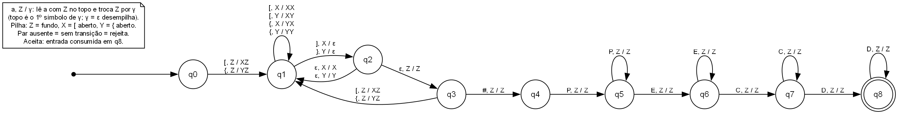

# Frente 1 — Gramática Livre de Contexto e Autômato de Pilha (AP)

> Responsável: Alberto.
> Implementação correspondente: [`src/ap/transicoes.py`](../../src/ap/transicoes.py) (tabela δ) e
> [`src/ap/automato_pilha.py`](../../src/ap/automato_pilha.py) (simulador).
> Tudo o que está neste documento (derivação, rastreamento, contagens e diagrama) foi gerado ou
> conferido executando esse código. A verificação completa está em
> [`verificar_ap.py`](verificar_ap.py) (seção 10).

---

## 1. Alfabeto e regra de formação

O AP recebe o **manifesto inteiro**, no formato `ESTRUTURA#LOTE`.

| Símbolo | Significado | Parte |
|---|---|---|
| `[` `]` | abre / fecha um **palete** | estrutura |
| `{` `}` | abre / fecha uma **caixa** | estrutura |
| `#` | separador entre estrutura e lote | — |
| `P` `E` `C` `D` | pedido, envio, confirmação, devolução | lote |

**Alfabeto de entrada:** Σ = { `[`, `]`, `{`, `}`, `#`, `P`, `E`, `C`, `D` } (9 símbolos)

**Linguagem reconhecida:**

$$L_{AP} = \{\, x\,\#\,y \;\mid\; x \in \Sigma_{e}^{+} \text{ é bem aninhada},\ y \in P^{+}E^{+}C^{+}D^{+} \,\}$$

com Σₑ = { `[`, `]`, `{`, `}` }.

**Regra de formação.** Uma cadeia *w* pertence a L_AP se, e somente se:

1. *w* tem exatamente um `#`;
2. a estrutura *x* (antes do `#`) **não é vazia** e é **bem aninhada**: todo `[` fecha com `]`, todo
   `{` fecha com `}`, e o último aberto é o primeiro a ser fechado (um palete pode conter caixas e
   vice-versa, mas não podem se cruzar: `[{]}` é inválido);
3. o lote *y* (depois do `#`) tem quatro blocos não vazios, nessa ordem: `P+ E+ C+ D+`.

As **quantidades** de P, E, C e D **não** são conferidas pelo AP: isso é trabalho do ALL (Frente 2).

| Cadeia | \|w\| | Decisão do AP |
|---|---|---|
| `[]#PECD` | 7 | aceita (menor cadeia aceita: caso-limite) |
| `[{}[{}]]{[]}#PPEEECCDDD` | 23 | aceita (cadeia da derivação, seção 4) |
| `[{}[{}]]{[]}#PPEEECCCDD` | 23 | aceita (P≠C e E≠D: quem rejeita é o ALL) |
| ε (vazia) | 0 | rejeita: termina em `q0` (caso-limite) |
| `#PECD` | 5 | rejeita: estrutura vazia, sem transição `(q0, #, Z)` |
| `[{}[{]}]{[]}#PPEEECCDDD` | 23 | rejeita: `]` com `{` aberto no topo, sem transição `(q1, ], Y)` |
| `[[]#PECD` | 8 | rejeita: `#` com `[` ainda aberto, sem transição `(q1, #, X)` |
| `[]][#PECD` | 9 | rejeita: `]` no nível externo, sem transição `(q3, ], Z)` |
| `[]#PEDC` | 7 | rejeita: D antes de C, sem transição `(q6, D, Z)` |
| `[]#PEC` | 6 | rejeita: lote sem D, termina em `q7` (não final) |

---

## 2. Por que L_AP **não é regular**

**Lema do bombeamento para linguagens regulares** (Sipser, seção 1.4; Hopcroft, Motwani e Ullman,
seção 4.1): se *L* é regular, existe *p* ≥ 1 tal que toda *s* ∈ *L* com |*s*| ≥ *p* pode ser escrita
como *s* = *xyz*, com |*y*| ≥ 1, |*xy*| ≤ *p* e *xyⁱz* ∈ *L* para todo *i* ≥ 0.

**Prova (por contradição).** Suponha L_AP regular e seja *p* o comprimento de bombeamento. Escolha

$$s = [^{\,p}\; ]^{\,p}\, \#PECD \in L_{AP}, \qquad |s| = 2p + 5 \ge p.$$

Como |*xy*| ≤ *p*, *x* e *y* estão dentro dos *p* primeiros símbolos, que são todos `[`. Logo
*y* = `[`ᵏ com *k* ≥ 1. Bombeando para baixo (*i* = 0):

$$xy^0z = [^{\,p-k}\; ]^{\,p}\, \#PECD$$

A estrutura tem *p* − *k* aberturas e *p* fechamentos, então não é bem aninhada e a cadeia ∉ L_AP.
(Com *i* = 2 também falha: sobram *k* paletes abertos.) Contradição: **L_AP não é regular.**

**Intuição.** Um autômato finito tem memória limitada, mas para aceitar `[ⁿ]ⁿ` precisa lembrar *n*,
que pode ser qualquer número. Além disso, com **dois tipos** de delimitador não basta um contador: é
preciso lembrar a **ordem** dos abertos (`[{` exige `}]`, não `]}`). Uma pilha faz exatamente isso.

---

## 3. GLC: G = (V, Σ, P, S)

- **Variáveis:** V = { S, B, A, L, Ps, Es, Cs, Ds }
- **Terminais:** Σ = { `[`, `]`, `{`, `}`, `#`, `P`, `E`, `C`, `D` }
- **Símbolo inicial:** S
- **Produções P:**

```
S  → B # L                       manifesto = estrutura # lote
B  → A | A B                     estrutura = 1 ou mais blocos lado a lado
A  → [ ] | [ B ] | { } | { B }   bloco = palete ou caixa, vazio ou com conteúdo
L  → Ps Es Cs Ds                 lote = P+ E+ C+ D+
Ps → P | P Ps
Es → E | E Es
Cs → C | C Cs
Ds → D | D Ds
```

(Na notação BNF compacta: `B → A+`, `A → [B?] | {B?}`.)

**Significado de cada variável.**

| Variável | Gera | Exemplo |
|---|---|---|
| A | **um** bloco: um palete ou uma caixa, com o que estiver dentro | `[{}[{}]]` |
| B | um ou mais blocos lado a lado (estrutura não vazia e bem aninhada) | `[{}[{}]]{[]}` |
| L | o lote `P+E+C+D+` | `PPEEECCDDD` |
| Ps, Es, Cs, Ds | um bloco não vazio de P, E, C, D | `PP` |

**A gramática não é ambígua.** Toda estrutura bem aninhada não vazia se decompõe de um só jeito em
blocos externos (cada um fecha quando a profundidade volta a 0), e cada bloco tem um único par de
delimitadores externo. O lote também tem uma única divisão em P+, E+, C+, D+. Por isso cada cadeia
tem uma única árvore de derivação — o que combina com o AP ser **determinístico** (seção 5).

---

## 4. Derivação de uma cadeia aceita (23 símbolos)

Cadeia: `[{}[{}]]{[]}#PPEEECCDDD` — estrutura com 2 blocos externos: o palete `[{}[{}]]` (que contém
uma caixa vazia e um palete com uma caixa) e a caixa `{[]}` (que contém um palete vazio); lote com 2 P,
3 E, 2 C, 3 D.

**Derivação mais à esquerda** (em cada passo, a regra é aplicada à variável mais à esquerda):

| # | Regra | Forma sentencial |
|---|---|---|
| 0 | — | S |
| 1 | S → B#L | B # L |
| 2 | B → AB | A B # L |
| 3 | A → [B] | [ B ] B # L |
| 4 | B → AB | [ A B ] B # L |
| 5 | A → {} | [ { } B ] B # L |
| 6 | B → A | [ { } A ] B # L |
| 7 | A → [B] | [ { } [ B ] ] B # L |
| 8 | B → A | [ { } [ A ] ] B # L |
| 9 | A → {} | [ { } [ { } ] ] B # L |
| 10 | B → A | [ { } [ { } ] ] A # L |
| 11 | A → {B} | [ { } [ { } ] ] { B } # L |
| 12 | B → A | [ { } [ { } ] ] { A } # L |
| 13 | A → [] | [ { } [ { } ] ] { [ ] } # L |
| 14 | L → Ps Es Cs Ds | [{}[{}]]{[]} # Ps Es Cs Ds |
| 15 | Ps → P Ps | [{}[{}]]{[]} # P Ps Es Cs Ds |
| 16 | Ps → P | [{}[{}]]{[]} # P P Es Cs Ds |
| 17 | Es → E Es | [{}[{}]]{[]} # P P E Es Cs Ds |
| 18 | Es → E Es | [{}[{}]]{[]} # P P E E Es Cs Ds |
| 19 | Es → E | [{}[{}]]{[]} # P P E E E Cs Ds |
| 20 | Cs → C Cs | [{}[{}]]{[]} # P P E E E C Cs Ds |
| 21 | Cs → C | [{}[{}]]{[]} # P P E E E C C Ds |
| 22 | Ds → D Ds | [{}[{}]]{[]} # P P E E E C C D Ds |
| 23 | Ds → D Ds | [{}[{}]]{[]} # P P E E E C C D D Ds |
| 24 | Ds → D | `[{}[{}]]{[]}#PPEEECCDDD` |

São 24 passos de derivação. Cada passo foi conferido por script (regra existe em G e é aplicada na
variável mais à esquerda).

**Árvore de derivação** da estrutura (o lote L é uma "escada" à direita:
Ps → P Ps → P P, Es → E Es → E E Es → E E E, e assim por diante):

```
                    S
          __________|__________
         B          #          L ⇒* PPEEECCDDD
    _____|______
   A            B
 __|____        |
[  B    ]       A
  _|__        __|__
 A    B      {  B  }
 |    |         |
{ }   A         A
    __|__       |
   [  B  ]     [ ]
      |
      A
      |
     { }
```

---

## 5. Especificação do AP

M = (Q, Σ, Γ, δ, q₀, Z, F)

### 5.1 Estados (9)

| Estado | Papel | Pilha nesse estado |
|---|---|---|
| `q0` | início: espera o primeiro bloco (a estrutura não pode ser vazia) | `Z` |
| `q1` | dentro de um bloco: empilha aberturas, desempilha fechamentos | ≥ 1 aberto sobre `Z` |
| `q2` | acabou de fechar um bloco: consulta o topo **sem ler** (só transições ε) | qualquer |
| `q3` | nível externo: já houve ≥ 1 bloco; abre outro bloco ou lê `#` | `Z` |
| `q4` | leu `#`: espera o primeiro `P` | `Z` |
| `q5` | bloco de `P` | `Z` |
| `q6` | bloco de `E` | `Z` |
| `q7` | bloco de `C` | `Z` |
| `q8` | bloco de `D` — **único estado final** | `Z` |

Por que `q0` e `q3` são estados diferentes, se os dois têm só `Z` na pilha? Porque `q3` aceita `#` e
`q0` não: é assim que o AP exige a estrutura **não vazia** (`#PECD` é rejeitada).

### 5.2 Alfabetos, configuração inicial e estados finais

- **Σ** (entrada) = { `[`, `]`, `{`, `}`, `#`, `P`, `E`, `C`, `D` }
- **Γ** (pilha) = { `Z`, `X`, `Y` }: `Z` = fundo da pilha; `X` = um `[` aberto; `Y` = um `{` aberto
- **Estado inicial:** `q0`; **símbolo inicial da pilha:** `Z`
- **Configuração inicial:** (`q0`, *w*, `Z`) — estado, entrada ainda não lida, pilha (topo à esquerda)
- **Estados finais:** F = { `q8` }

### 5.3 Tabela de transições

Notação: δ(q, a, t) = (q', γ) significa "no estado q, lendo a (ou ε, sem ler), com t no topo: vai
para q' e troca t por γ". O topo é o primeiro símbolo de γ; γ = ε desempilha. Toda combinação que
não está na tabela **não tem transição**: o AP trava e **rejeita**.

| # | Estado | Lê | Topo | → Estado | Empilha (no lugar do topo) | Significado |
|---|---|---|---|---|---|---|
| 1 | q0 | `[` | Z | q1 | XZ | abre o 1º palete |
| 2 | q0 | `{` | Z | q1 | YZ | abre a 1ª caixa |
| 3 | q1 | `[` | X | q1 | XX | palete dentro de palete |
| 4 | q1 | `[` | Y | q1 | XY | palete dentro de caixa |
| 5 | q1 | `{` | X | q1 | YX | caixa dentro de palete |
| 6 | q1 | `{` | Y | q1 | YY | caixa dentro de caixa |
| 7 | q1 | `]` | X | q2 | ε | fecha palete (topo tem de ser `[`) |
| 8 | q1 | `}` | Y | q2 | ε | fecha caixa (topo tem de ser `{`) |
| 9 | q2 | ε | Z | q3 | Z | fechou um bloco externo: volta ao nível externo |
| 10 | q2 | ε | X | q1 | X | ainda dentro de um palete |
| 11 | q2 | ε | Y | q1 | Y | ainda dentro de uma caixa |
| 12 | q3 | `[` | Z | q1 | XZ | abre outro palete externo |
| 13 | q3 | `{` | Z | q1 | YZ | abre outra caixa externa |
| 14 | q3 | `#` | Z | q4 | Z | fim da estrutura |
| 15 | q4 | `P` | Z | q5 | Z | 1º pedido |
| 16 | q5 | `P` | Z | q5 | Z | mais pedidos |
| 17 | q5 | `E` | Z | q6 | Z | 1º envio |
| 18 | q6 | `E` | Z | q6 | Z | mais envios |
| 19 | q6 | `C` | Z | q7 | Z | 1ª confirmação |
| 20 | q7 | `C` | Z | q7 | Z | mais confirmações |
| 21 | q7 | `D` | Z | q8 | Z | 1ª devolução |
| 22 | q8 | `D` | Z | q8 | Z | mais devoluções |

São 22 transições. Na parte do lote (`q4`…`q8`) a pilha fica parada em `Z`: essa parte é regular e
funciona como um autômato finito.

**O AP é determinístico (APD).** Em cada configuração existe no máximo uma transição aplicável: as
transições ε existem só em `q2`, e `q2` não tem nenhuma transição de leitura; nos outros estados, cada
par (símbolo lido, topo) aparece no máximo uma vez. Não há escolhas a explorar, e o simulador segue um
único caminho.

### 5.4 Critério de aceitação

**Aceitação por estado final:** *w* é aceita se, e somente se, o AP **consome a entrada inteira** e
termina em `q8`. Rejeita se:

- trava antes do fim (não há transição para (estado, símbolo, topo)) — ex.: fechamento trocado, `#`
  com bloco aberto, lote fora de ordem, segundo `#`; ou
- consome tudo, mas para fora de `q8` — ex.: entrada vazia (`q0`), lote incompleto (`q4`…`q7`).

Ao aceitar, a pilha contém só `Z`. Por isso também seria possível aceitar **por pilha vazia**,
acrescentando a transição δ(q8, ε, Z) = (q8, ε) a ser usada só no fim da entrada; preferimos estado
final porque o simulador fica mais simples (o AP continua determinístico).

---

## 6. Relação GLC ↔ AP (o que o AP faz com cada regra)

| Regra da GLC | Transições do AP | Ideia |
|---|---|---|
| A → `[` B `]` / A → `[` `]` | 1, 3, 4, 12 (empilha X ao ler `[`) e 7 (desempilha X ao ler `]`) | o `]` que fecha A é o que encontra **o mesmo X** no topo |
| A → `{` B `}` / A → `{` `}` | 2, 5, 6, 13 (empilha Y) e 8 (desempilha Y) | idem para caixas |
| B → A B (B dentro de um bloco) | 10, 11 (volta a `q1` se ainda há abertos) | depois de fechar um bloco interno, pode vir outro |
| B → A B (nível externo) e S → B # L | 9 (`q2`→`q3`), 12, 13, 14 | no nível externo: mais um bloco ou `#` |
| B → A (exige ≥ 1 bloco) | `q0` não lê `#` | estrutura vazia é rejeitada |
| L → Ps Es Cs Ds, Ps → P \| P Ps, … | 15–22 | um estado por bloco do lote |

A pilha guarda **a sequência de produções A ainda não terminadas**: cada X/Y na pilha é um palete/caixa
cujo símbolo de fechamento ainda não foi lido. A recursão da gramática (A → `[` B `]` dentro de outro A)
vira empilhar sobre o que já está lá.

---

## 7. Justificativa: L(M) = L(G)

**Passo 1 — o que B gera.** B gera exatamente as cadeias não vazias bem aninhadas sobre Σₑ.
(⊆) Por indução na derivação: `[]`, `{}` são bem aninhadas; envolver uma bem aninhada com `[ ]` ou
`{ }`, ou concatenar duas, mantém a propriedade. (⊇) Por indução no comprimento: uma cadeia bem
aninhada não vazia *x* começa com uma abertura; seja *a* o símbolo que a fecha. Então *x* = *a u ā v*,
com *u* e *v* bem aninhadas (talvez vazias). *a u ā* é gerada por A (A → *a* *ā* se *u* = ε, ou
A → *a* B *ā* pela hipótese de indução), e *v* é vazia (use B → A) ou gerada por B (use B → A B).
Logo L(G) = { *x* `#` *y* | *x* bem aninhada não vazia, *y* ∈ P⁺E⁺C⁺D⁺ } = L_AP (seção 1).

**Passo 2 — invariante do AP na estrutura.** Seja *u* o prefixo da estrutura já lido e defina
h(`[`) = X, h(`{`) = Y. Por indução em |*u*|, depois de fazer a transição ε de `q2` (quando houver):

1. se *u* não é prefixo de nenhuma cadeia bem aninhada, o AP **já travou** (rejeitou);
2. senão, se *u* tem aberturas pendentes *a₁ … aₖ* (*k* ≥ 1, *aₖ* a mais recente), o AP está em `q1`
   com pilha h(*aₖ*) … h(*a₁*) Z;
3. senão (*u* é bem aninhada), o AP está em `q0` se *u* = ε e em `q3` se *u* ≠ ε, com pilha `Z`.

O passo indutivo é a leitura da tabela: uma abertura empilha o X/Y correspondente (transições 1–6,
12, 13); um fechamento só tem transição se o topo for o do mesmo tipo (7, 8) — que é exatamente a
abertura pendente mais recente; depois disso, `q2` olha o topo e vai para `q1` (ainda há pendentes) ou
`q3` (topo `Z`, nível externo). Qualquer outro símbolo nesses estados não tem transição.

**Passo 3 — o `#` e o lote.** Só existe transição com `#` a partir de `q3`, ou seja (pelo passo 2),
exatamente quando a estrutura lida é bem aninhada e não vazia. A partir daí, `q4`…`q8` formam um
autômato finito determinístico para P⁺E⁺C⁺D⁺ (a pilha fica em `Z`), com `q8` final. Um segundo `#`
ou qualquer símbolo de estrutura depois do `#` não tem transição.

**Conclusão.** M termina em `q8` com a entrada consumida ⇔ *w* = *x* `#` *y* com *x* bem aninhada não
vazia e *y* ∈ P⁺E⁺C⁺D⁺ ⇔ *w* ∈ L(G). Portanto **L(M) = L(G) = L_AP**, e L_AP é livre de contexto (e,
mais que isso, livre de contexto **determinística**).

**Conferência por computador** ([`verificar_ap.py`](verificar_ap.py)):
- o conjunto de cadeias geradas pela GLC e o conjunto aceito pelo AP são **iguais** para todos os
  comprimentos até 16 (23 670 cadeias);
- AP = definição da seção 1 em **todas** as 5 380 840 cadeias de Σ\* com até 7 símbolos e em 20 000
  cadeias aleatórias de até ~34 símbolos (variações de cadeias aceitas com trocas, inserções e remoções);
- o invariante do passo 2 (pilha sempre da forma (X|Y)\* Z) vale em todas as configurações alcançadas.

---

## 8. Terminação e número de passos

Cada transição de leitura consome um símbolo. As transições ε só existem em `q2`, e `q2` sempre vai
para `q1` ou `q3`, que não têm transições ε; logo há no máximo **uma** transição ε por símbolo de
fechamento lido. Total de passos ≤ |*w*| + (nº de `]` e `}`) ≤ 2|*w*|, e o AP sempre para — aceitando
ou travando. Exemplo: a cadeia da seção 4 tem 23 símbolos e 6 fechamentos → 29 passos. O limite
2|*w*| foi verificado em todas as cadeias com até 7 símbolos.

---

## 9. Rastreamento

```bash
python -m src.main "[{}[{}]]{[]}#PPEEECCDDD" --so ap --trace
```

```
   0 | q0  | pos=0   | resta=[{}[{}]]{[]}#PPEEECCDDD      | pilha=Z            | configuração inicial
   1 | q1  | pos=1   | resta={}[{}]]{[]}#PPEEECCDDD       | pilha=XZ           | leu [, topo Z -> empilha XZ
   2 | q1  | pos=2   | resta=}[{}]]{[]}#PPEEECCDDD        | pilha=YXZ          | leu {, topo X -> empilha YX
   3 | q2  | pos=3   | resta=[{}]]{[]}#PPEEECCDDD         | pilha=XZ           | leu }, topo Y -> empilha ε
   4 | q1  | pos=3   | resta=[{}]]{[]}#PPEEECCDDD         | pilha=XZ           | leu ε, topo X -> empilha X
   5 | q1  | pos=4   | resta={}]]{[]}#PPEEECCDDD          | pilha=XXZ          | leu [, topo X -> empilha XX
   6 | q1  | pos=5   | resta=}]]{[]}#PPEEECCDDD           | pilha=YXXZ         | leu {, topo X -> empilha YX
   7 | q2  | pos=6   | resta=]]{[]}#PPEEECCDDD            | pilha=XXZ          | leu }, topo Y -> empilha ε
   8 | q1  | pos=6   | resta=]]{[]}#PPEEECCDDD            | pilha=XXZ          | leu ε, topo X -> empilha X
   9 | q2  | pos=7   | resta=]{[]}#PPEEECCDDD             | pilha=XZ           | leu ], topo X -> empilha ε
  10 | q1  | pos=7   | resta=]{[]}#PPEEECCDDD             | pilha=XZ           | leu ε, topo X -> empilha X
  11 | q2  | pos=8   | resta={[]}#PPEEECCDDD              | pilha=Z            | leu ], topo X -> empilha ε
  12 | q3  | pos=8   | resta={[]}#PPEEECCDDD              | pilha=Z            | leu ε, topo Z -> empilha Z
  13 | q1  | pos=9   | resta=[]}#PPEEECCDDD               | pilha=YZ           | leu {, topo Z -> empilha YZ
  14 | q1  | pos=10  | resta=]}#PPEEECCDDD                | pilha=XYZ          | leu [, topo Y -> empilha XY
  15 | q2  | pos=11  | resta=}#PPEEECCDDD                 | pilha=YZ           | leu ], topo X -> empilha ε
  16 | q1  | pos=11  | resta=}#PPEEECCDDD                 | pilha=YZ           | leu ε, topo Y -> empilha Y
  17 | q2  | pos=12  | resta=#PPEEECCDDD                  | pilha=Z            | leu }, topo Y -> empilha ε
  18 | q3  | pos=12  | resta=#PPEEECCDDD                  | pilha=Z            | leu ε, topo Z -> empilha Z
  19 | q4  | pos=13  | resta=PPEEECCDDD                   | pilha=Z            | leu #, topo Z -> empilha Z
  20 | q5  | pos=14  | resta=PEEECCDDD                    | pilha=Z            | leu P, topo Z -> empilha Z
  21 | q5  | pos=15  | resta=EEECCDDD                     | pilha=Z            | leu P, topo Z -> empilha Z
  22 | q6  | pos=16  | resta=EECCDDD                      | pilha=Z            | leu E, topo Z -> empilha Z
  23 | q6  | pos=17  | resta=ECCDDD                       | pilha=Z            | leu E, topo Z -> empilha Z
  24 | q6  | pos=18  | resta=CCDDD                        | pilha=Z            | leu E, topo Z -> empilha Z
  25 | q7  | pos=19  | resta=CDDD                         | pilha=Z            | leu C, topo Z -> empilha Z
  26 | q7  | pos=20  | resta=DDD                          | pilha=Z            | leu C, topo Z -> empilha Z
  27 | q8  | pos=21  | resta=DD                           | pilha=Z            | leu D, topo Z -> empilha Z
  28 | q8  | pos=22  | resta=D                            | pilha=Z            | leu D, topo Z -> empilha Z
  29 | q8  | pos=23  | resta=ε                            | pilha=Z            | leu D, topo Z -> empilha Z
     entrada consumida em q8 (final) -> ACEITA
```

Rejeição por aninhamento cruzado (`[{}[{]}]{[]}#PPEEECCDDD`, final do rastro):

```
   5 | q1  | pos=4   | resta={]}]{[]}#PPEEECCDDD          | pilha=XXZ          | leu [, topo X -> empilha XX
   6 | q1  | pos=5   | resta=]}]{[]}#PPEEECCDDD           | pilha=YXXZ         | leu {, topo X -> empilha YX
     sem transição para (q1, ']', Y) -> REJEITA
```

O `]` chegou com um `{` (Y) no topo: a caixa aberta por último ainda não foi fechada.

**Como prever a decisão de uma cadeia nova (para a arguição).** Leia a estrutura mantendo a pilha de
abertos: cada `[`/`{` empilha X/Y; cada `]`/`}` precisa encontrar X/Y no topo, senão rejeita. O `#` só
passa com a pilha em `Z` e pelo menos um bloco lido. Depois, o lote tem de ser P…E…C…D…, cada bloco
com pelo menos um símbolo, e a cadeia tem de acabar num `D`.

---

## 10. Diagrama e origem



- Arquivos: [`ap_diagrama.svg`](ap_diagrama.svg) (vetorial, para o relatório e os slides),
  [`ap_diagrama.png`](ap_diagrama.png) e a fonte [`ap_diagrama.dot`](ap_diagrama.dot).
- **Origem:** gerado pela equipe com o script [`gerar_diagrama_ap.py`](gerar_diagrama_ap.py), que lê
  **a mesma tabela** usada pelo simulador (`src/ap/transicoes.py`) e escreve o `.dot`; a renderização
  é feita com o Graphviz (`dot`). Diagrama e código não podem divergir. Para regenerar:

```bash
python docs/modelagem/gerar_diagrama_ap.py
dot -Tsvg docs/modelagem/ap_diagrama.dot -o docs/modelagem/ap_diagrama.svg
dot -Tpng -Gdpi=150 docs/modelagem/ap_diagrama.dot -o docs/modelagem/ap_diagrama.png
```

- Rótulo `a, t / γ`: lê *a* (ou ε) com *t* no topo e troca *t* por γ. Pares ausentes não têm
  transição (rejeita).

Verificação da tabela (leva ~2 min):

```bash
python docs/modelagem/verificar_ap.py
```

```
determinismo: ok (22 transições, 9 estados)
GLC = AP para |w| <= 16: ok (23670 cadeias); invariante da pilha: ok
força bruta |w| <= 7: ok (5380840 cadeias, 2 aceitas)
20000 cadeias aleatórias (até ~34 símbolos): ok
```

---

## 11. Revisão da tabela `src/ap/transicoes.py` (Frente 1)

| Item verificado | Resultado |
|---|---|
| Nº de estados ≥ 8 | 9 (`q0`…`q8`) ✔ |
| Determinismo | ε só em `q2`, que não lê; uma transição por (estado, símbolo, topo) ✔ |
| GLC do docstring = GLC deste documento | ✔ |
| Reconhece exatamente L(GLC) | ✔ prova (seção 7) + conferência por computador |
| Estrutura vazia rejeitada; dois tipos de delimitador não se cruzam | ✔ (`#PECD`, `[{]}#PECD`) |
| Para em toda entrada, com ≤ 2\|w\| passos | ✔ (seção 8) |

A tabela foi aprovada sem mudanças de lógica.

---

## Referências

- SIPSER, M. *Introdução à Teoria da Computação*. 2. ed. São Paulo: Cengage Learning, 2007.
  Seção 1.4 (linguagens não regulares e lema do bombeamento) e seções 2.1–2.2 (gramáticas livres do
  contexto e autômatos com pilha).
- HOPCROFT, J. E.; MOTWANI, R.; ULLMAN, J. D. *Introdução à Teoria de Autômatos, Linguagens e
  Computação*. 2. ed. Rio de Janeiro: Campus/Elsevier, 2002. Seção 4.1 (lema do bombeamento para
  linguagens regulares), capítulo 5 (GLC, árvores de derivação, ambiguidade) e capítulo 6 (autômatos
  de pilha, aceitação por estado final × pilha vazia, APD).
- MENEZES, P. B. *Linguagens Formais e Autômatos*. 6. ed. Porto Alegre: Bookman, 2011. Capítulos
  sobre linguagens livres do contexto e autômato com pilha.
